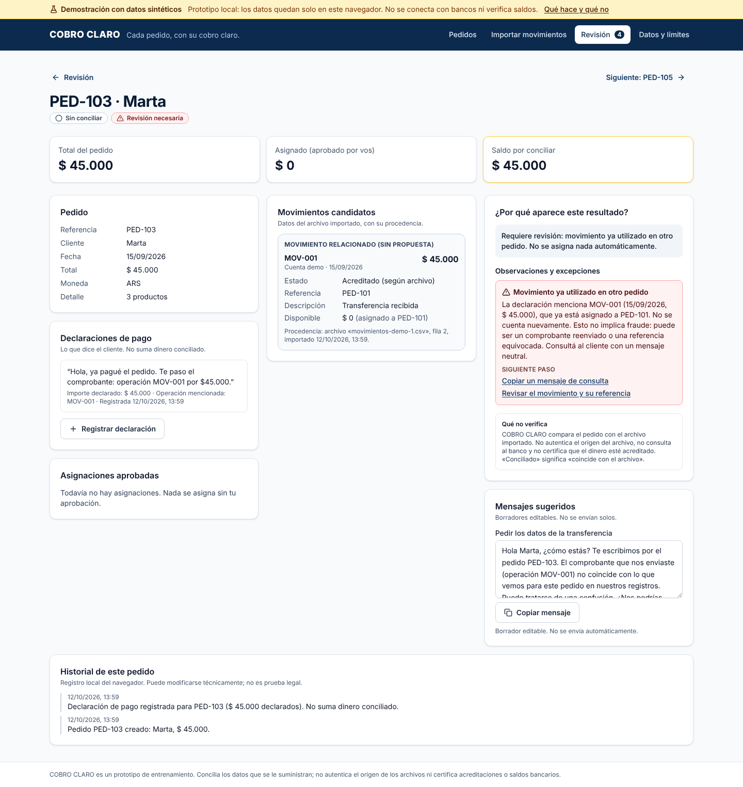

# COBRO CLARO

> **Cada pedido, con su cobro claro.**

Prototipo funcional para pequeños comercios que reciben pedidos por mensajes: relaciona cada pedido con
los movimientos de un **archivo importado**, propone asociaciones con reglas explícitas, pide **aprobación
humana** y explica cada resultado con su siguiente acción.

**Prototipo de entrenamiento con datos sintéticos.** No es un banco, ni una billetera, ni un detector de fraude,
ni certifica acreditaciones. Un archivo importado no es una conexión bancaria. Ver [limitaciones](docs/LIMITACIONES.md).



## Requisitos
- Node.js ≥ 20.9 (probado con **Node 22.22** y npm 10.9).
- Para pruebas de navegador: Chromium de Playwright (`npx playwright install chromium` si no lo tenés).

## Instalar y ejecutar
```bash
npm ci                    # instala exactamente lo del lockfile
npm run dev               # desarrollo: http://localhost:3000
# o, como en la demo:
npm run build && npm start
```
Abrí http://localhost:3000 → **Cargar ejemplo**. La app funciona sin conexión a servicios externos una vez
instaladas las dependencias (no es una PWA offline: necesita el servidor local).

> Para **agregar** dependencias usá `npx npm@11 install …` (npm 10.9 tiene un error al resolver Vitest 4).

## Pruebas
```bash
npm run check      # tipos (tsc) + lint (eslint) + unitarias (vitest)
npm run test:e2e   # Playwright: compila, levanta :3100 y recorre la app en escritorio y móvil (incluye axe)
npm run capturas   # capturas y video del recorrido (requiere npm start en :3000)
```

## Recorrido de la demo
Guion de 90 segundos y valores esperados: [docs/DEMO.md](docs/DEMO.md). Video: `docs/demo/recorrido-demo.webm`.

## IA opcional
Desactivada por defecto. Para activarla en un servidor propio, copiá `.env.example` a `.env.local` y completá
`AI_EXTRACTION_ENABLED=true`, `ANTHROPIC_API_KEY` y `EXTRACTION_MODEL`. Solo arma borradores de pedidos; nunca decide pagos.
No publiques la app con la IA activa sin autenticación y control de gasto.

## Estructura
```
src/domain      reglas puras: dinero, referencias, conciliación, mensajes, asignaciones
src/importing   CSV (PapaParse), plan de importación y cambios
src/storage     IndexedDB (Dexie): transacciones, respaldo
src/extraction  extracción por reglas, validación semántica, adaptador API (servidor)
src/demo        datos sintéticos (solo entradas)
src/app         pantallas: Pedidos, Nuevo pedido, Importar, Revisión, Datos y límites; /api/extraer
tests/unit      Vitest     tests/e2e  Playwright
```

## Documentación
| | |
|---|---|
| [docs/PRODUCTO.md](docs/PRODUCTO.md) | Concepto, alcance, arquitectura y modelo de datos |
| [docs/REGLAS.md](docs/REGLAS.md) | Tabla de decisiones de conciliación |
| [docs/FORMATO_CSV.md](docs/FORMATO_CSV.md) | Formato del archivo de movimientos |
| [docs/VALIDACION.md](docs/VALIDACION.md) | Ficha de negocio, alternativas, entrevistas y piloto |
| [docs/DEMO.md](docs/DEMO.md) | Guion de demo y respaldo |
| [docs/PITCH.md](docs/PITCH.md) | Presentación de 6 diapositivas y preguntas difíciles |
| [docs/LIMITACIONES.md](docs/LIMITACIONES.md) | Qué hace, qué no, y riesgos conocidos |
| [docs/EVENTO.md](docs/EVENTO.md) | NEA TECH: confirmado, pendiente y supuestos |
| [CLAUDE.md](CLAUDE.md) | Reglas del proyecto para asistentes |

## Origen del trabajo
Desarrollado el 12/10/2026 con asistencia de IA (Claude Code), antes del NEA TECH 2026. Antes de usarlo en una
entrega oficial hay que confirmar las reglas del evento sobre desarrollo previo y asistencia de IA ([docs/EVENTO.md](docs/EVENTO.md)).
